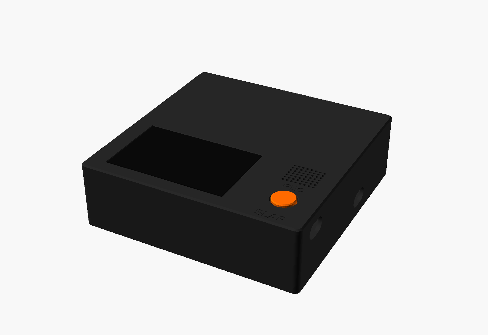
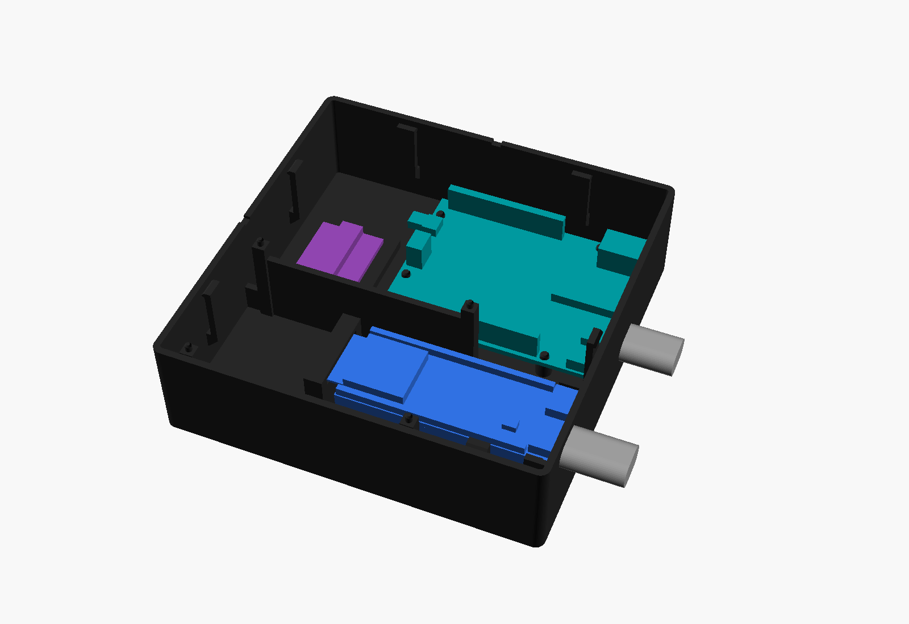

# Slap housing (v3.1): deep, screwless slab

Parametric OpenSCAD housing for the Slap desk device. The front zone holds the ESP32-S3-DevKitC-1 (N16R8 clone), 2.42" SSD1309 OLED, INMP441 mic, 5 mm LED and the 12 mm record button over BOOT. The back bay holds the Arduino UNO R4 WiFi and the SunFounder 10-axis IMU on its Qwiic cable. One file, `housing_slab.scad`, is the source of truth; everything else here (STLs, print plates, STEP for Fusion, previews) is generated from it.




| Printer | Bambu Lab P2S, 0.4 nozzle, textured PEI, black PLA, 0.20 mm Standard, no supports |
|---|---|
| Outer size | **116.0 × 116.5 × 35.4 mm**, 3 mm corner radius, 0.8 mm top chamfer |
| Parts | tray, lid, button. Screwless: six cantilever snap hooks on the tray click into windows in the lid skirt. |
| Coupon plate (print first) | `print/Slap_fit_tests_black_0.4.3mf`, eight coupons, 230 × 112 mm on the bed |
| Housing plate | `print/Slap_housing_black_0.4.3mf` (tray, lid face-down, button on its cap), 240 × 138 mm on the bed. Not sliced yet, so there is no time or weight figure; the solid volume is 1.87 times v2.3's (53 g, 1 h 58 min). |
| Fusion | `cad/Slap_housing.step` (B-rep solids, see the STEP section) |

Previews: `preview/assembled_black.png`, `assembled_front.png`, `slab_top.png`, `slab_back.png` (the USB end, both slots), `open_box.png` (tray with the three boards in place), `lid_under.png`, `exploded.png`. The three `tray_v23*.png` files show the old v2.3 tray.

## Revision history

| Version | Date | What |
|---|---|---|
| v1 | 6 Oct | Angled wedge, screws, loose plunger. Superseded and removed. |
| v2 / v2.1 | 7 Oct | Flat slab, snap-fit lid, Duponts hang under the board on its long pins, two pedestals + snap tabs hold the board. |
| v2.2 | 8 Oct | IMU on a rigid pedestal under the OLED. Print plates and STEP export. |
| v2.3 | 10 Oct | First print and coupons measured. OLED PCB pocket resized, OLED sandwiched by four tray posts, mic pocket 15.2, rigid USB-end cradle instead of snap tabs. 104.5 × 56 × 31.4 mm. |
| **v3.0** | 10 Oct | Deep slab. The UNO R4 WiFi and the SunFounder IMU move inside, behind the OLED. Assumed dimensions get extra room. 116 × 116.5 × 35.4 mm. Later the same day: OLED header is on the left short side, so the two left posts move in and the lid seat is relieved over the pins. |
| **v3.1** | 10 Oct | Sturdier: snap hooks 2.0 mm thick (were 1.2) on a longer beam, six instead of seven; OLED posts braced by a divider wall and ties to the front wall; antenna gate on a solid block; conical lid posts. OLED: a locating pin on each tray post, into the board's corner holes. |

## What changed in v3.1 (sturdier)

The builder's review of v3.0: the snap coupon would break too easily, and the tall stands and snaps in the tray looked fragile.

| Feature | v3.0 | v3.1 |
|---|---|---|
| Snap hook beam | 1.2 thick, 5 wide, 9 long | **2.0 thick, 6 wide, 16 long**. The longer beam bends less sharply: peak strain 0.64 %, was 1.22 %. The force to deflect one hook is unchanged (stiffness goes with thickness³ ÷ length³). |
| Hook count | 7 | 6: two left, two back, one front, one right |
| Skirt under each catch window | 1.2 tall, on a 3 mm skirt | 1.6 tall, on a 4 mm skirt |
| OLED posts (4 × 4 mm, 29 mm tall) | four free-standing posts | The back pair stands on a 2 mm divider wall between the front zone and the back bay; the front pair is tied to the front wall. Only the top 5 mm (back) and 2.4 mm (front) of each post is free. |
| Antenna gate | centre shelf and two free-standing 26 mm pillars | one solid block with the tunnel through its top |
| Lid posts onto the UNO headers | Ø5 rods, 16 mm long | cones, Ø9 at the lid to Ø5 at the tip |
| OLED location | corner posts press on the PCB corners | The posts are centred on the four corner holes and each carries a Ø2.0 pin, 2.4 mm tall, into its Ø3.0 hole. The pin tips pass through the PCB into blind reliefs in the lid. The window and pocket edges the OLED meets first have 0.4 mm lead-in chamfers. |

Unchanged: the UNO standoffs (Ø5, 5 mm tall) and the dev-board pedestals and cradle, which are short or solid already.

**Where the OLED hole positions come from.** The builder sent a screenshot of a CAD model of the module (10 Oct) and said its corner holes are about the same as this board's. Scaled from the screenshot, the model is a different variant of the board, about 72 × 43 mm against this board's measured 70.1 × 48.0, so only the corner detail is used: 3.0 mm holes centred 2.0 mm from both edges. On this board that puts the holes on 66.1 × 44.0 mm centres. The pins are Ø2.0, so each hole can be up to 0.5 mm off in any direction. `fit_oled_pins` on the coupon plate checks it; if the board does not drop on, the pins snip off and the posts still hold the OLED as before.

The divider wall is full height only between the two back posts. From the left post to the left wall it drops to 8.8 mm above the floor, so it passes 2 mm under the OLED header's jumper plugs wherever the header sits on that side.

## What changed in v3.0

**New parts inside**

| Part | How it is held |
|---|---|
| Arduino UNO R4 WiFi | Four Ø5 standoffs, 5 mm tall, at the datasheet mounting holes, each with a Ø2.6 peg in the Ø3.2 hole. Two conical lid posts (Ø5 at the tip) stop 0.5 mm above the two header rows, so the board cannot lift off the pegs. Its USB-C leaves through a second slot in the right end wall. |
| SunFounder 10-axis IMU | A flat 30 × 34 mm pad, 3 mm above the floor, in the back-left bay. Stick the board down with thin double-sided tape. Four corner pegs are in the file but off (`imu_pegs = false`) until the hole spacing is measured; SunFounder publishes no drawing. |

**Extra room for dimensions that are still assumed**

| Where | v2.3 | v3.0 | Covers |
|---|---|---|---|
| Under the hanging Duponts, `floor_clear` | 0.5 | 2.5 | Duponts longer than 14 mm, stiffer wire bends |
| Above the ESP32 module, `top_clear` | 0.5 | 1.5 | a taller shield can |
| Behind the OLED PCB, `oled_back_keep` | 1.0 | 2.0 | taller parts on the OLED back |
| Dev board between the cradle cheeks, `dev_clear` | 0.2 per side | 0.4 per side | a clone PCB wider than 25.4 |
| Antenna end of the dev board | cantilever catch, ±0.5 mm in length | tunnel under a bridged bar, open at both ends, ±2.5 mm | a clone PCB of a different length |
| Button nose, `btn_nose` | Ø3.5 | Ø5.0 | a BOOT key up to 0.7 mm off its drawing position |
| USB-C slots, `usb_plug_w/h` | 12.8 × 7.3 | 13.6 × 8.1 | chunkier cable overmolds |
| Length left over beside the OLED | 0.25 | 11.75 | wiring room between the OLED and the control column |

The fits already checked on the first print are unchanged: OLED window, OLED PCB pocket, mic pocket, LED socket, button bore, snap hooks.

**Other changes**

- The LED moved one grille pitch back (`led_dy` 1.1 → 2.2). With the wider cradle its flange touched the back cheek.
- The front-left catch window moved 0.3 mm off the OLED fence. The two shared a face, which left zero-area slivers in the lid STL; the lid now exports watertight with no repair step.
- `print/build_plates.py` no longer flips the lid and the button. OpenSCAD already exports them in print orientation, so the v2.3 plate file had the lid standing on its posts and the button on its nose. The script now stops if either part is not on its largest flat face.

## Outer dimensions

**116.0 × 116.5 × 35.4 mm** (L × W × H).

| Part | Thickness |
|---|---|
| Walls | 2.0 mm |
| Top plate | 2.0 mm, plus a 4 mm skirt that registers inside the tray with 0.2 mm clearance per side |
| Floor | 2.0 mm |

The parts set the size (`L_req`, `L_uno`, `W_req` in the echo output):
- **Length:** the back bay. UNO (68.58) + 3.5 to the end wall + 6 for the Qwiic plug + the 30 mm IMU pad + 3.5 to the left wall = 115.6. The front zone needs only 104.25.
- **Depth:** OLED PCB pocket (48.4) at the front wall + 3 mm gap + UNO (53.34) + 5 to the back wall = 116.1.

## Height budget

**The dev board column** (Duponts hang under the board):

| Layer | mm | z top |
|---|---|---|
| Floor, `floor_t` | 2.0 | 2.0 |
| Clearance, `floor_clear` | 2.5 | 4.5 |
| Wire exit and bend, `wire_bend` | 2.0 | 6.5 |
| F/F Dupont housing, `jumper_h` | 14.0 | 20.5 |
| Header plastic spacer, `header_spacer` | 2.5 | **23.0** = PCB bottom |
| Dev-board PCB | 1.6 | 24.6 |

The long pins (`dev_pin_below` 9.0, including the spacer) leave 6.5 mm of pin inside each Dupont; at least 6 mm is needed.

**Above the board, H is the largest of four stacks:**

| Stack | Layers | H |
|---|---|---|
| **OLED over the ESP32 module (sets H)** | PCB top 24.6 + module shield 3.2 + clearance 1.5 + OLED back parts 2.0 (assumed) + OLED PCB and glass 4.07 (glass flush) | **35.37** |
| Button column | PCB top 24.6 + short pins and solder 2.5 + clearance 0.3 + collar 0.8 and cone + 1.0 upward play + lid 2.0 | 31.7 |
| USB posts | PCB top 24.6 + USB-C 3.26 + 0.2 + post of at least 1 + lid 2.0 | 31.06 |
| UNO DC jack | PCB top 8.6 + jack 11.0 (assumed) + 1 + lid 2.0 | 22.6 |

The UNO is low, so the back bay has about 14 mm of free height above its headers for the Qwiic cable.

**OLED and mic headers (the builder solders these).** Fit the header strips with the **long side of the pins pointing into the housing**, at least 6 mm of pin past the plastic spacer, so the Duponts grip.

| Side | Stack | Dupont bottom |
|---|---|---|
| OLED (header on the left short side, next to the left wall) | OLED back z 31.3, minus spacer 2.5, minus Dupont 14, minus wire bend 2 | z 12.8 |
| Mic | lid underside 33.37, minus PCB 1, minus spacer 2.5, minus Dupont 14, minus wire bend 2 | z 13.9 |
| LED | Duponts on the legs | z 9.8 |

None of these hang over the dev board or the UNO.

## Layout

**Top face.** The OLED and the control column sit in the front 56 mm, as in v2.3. The back 60 mm of the lid is blank.
- **OLED:** window 63.41 × 40.45 mm (measured glass plus `tol_window` 0.3 per side), in the front-left corner. The glass sits flush on a 3.07 mm seat. The 70.1 × 48 mm PCB sits in a pocket under the lid and is pressed up into it by four 4 mm posts in the tray, one under each corner hole, each with a locating pin (`oled_pins`). The lid-side necked pegs and fork clips are still in the file (`oled_pegs`) but off. The **4-pin header is on the left short side** (builder, 10 Oct), between the two left corner holes, long pin ends out the back, soldered ends just proud of the front; the lid seat is cut back 1.0 mm over the whole left strip (`oled_hdr_relief`) so the soldered ends do not hold the PCB off its seat. The right short side is directly above the dev board, where only 6.7 mm is free and a Dupont needs 18.5; a module with its header there goes in rotated 180° with `U8G2_R2` in `firmware/esp32/src/display.cpp`.
- **Control column**, centred on BOOT:
  - Mic grille: 8 × 7 dot grid of 1.2 mm holes at 2.2 mm pitch. The mic port is under a hole.
  - 3 mm LED window, right of the grille and one pitch further back.
  - **REC** label, the **12 mm orange record button** (captive: a 13.6 mm collar under the guide bore, a Ø5 nose on BOOT), **SLAP** label.
  - Both labels are engraved 0.4 mm deep in Helvetica Neue Bold, with every stroke at least 0.5 mm.

**Inside the tray, front zone:**
- **Dev board supports:** two pedestals 21 mm tall under the board's bare centre strip.
- **USB-end cradle:** a ledge fused to the end wall under the 6.3 mm pin-free strip, full height under each PCB edge and dropped 1.2 mm in the middle for the USB shell anchor legs, with 2 mm cheeks 0.4 mm from each PCB edge. Two lid posts press down on the USB-C shells.
- **Antenna gate:** a solid block, 26 mm wide, reaching 0.4 mm under the module's antenna end, with a short 3.2 mm pillar on each side and a 1.6 mm bar bridged across them 1.0 mm above the module PCB. The antenna slides through the tunnel; nothing stops it lengthwise.

**Inside the tray, back bay:**
- **UNO R4 WiFi** against the right end wall, USB-C toward +X, DC-jack side toward the back wall. PCB at z 7.0–8.6.
- **IMU pad** in the back-left corner, its front edge level with the UNO's front edge, 6.4 mm from the UNO's far end where the Qwiic socket opens.

**Shell:**
- **Lid joint:** six snap hooks: two on the left wall, two on the back, one on the front (midway between the OLED and the right wall), one on the right wall between the LED socket and the UNO. Each beam is 2.0 thick, 6 wide and 16 long, with a 0.8 lip and a 45° lead-in, 0.25 mm (`tol_snap`) from the skirt.
- **Pry slots:** 3 × 1 mm, one at the centre of the back edge and one on the left edge between the two hooks.
- **Right end wall:** two USB-C slots, 13.6 × 8.1 mm. The dev board's is high (centre z 26.2), the UNO's low (centre z 10.1) and further back.
- **Underside:** four foot recesses, and the NFC recess centred under the OLED.

## Arduino UNO R4 WiFi

All positions are from section 13 of Arduino's datasheet ABX00087: `u` is measured from the USB edge, `v` from the DC-jack-side edge.

| Feature | Datasheet value | In the model |
|---|---|---|
| Outline | 68.58 × 53.34 | `uno_len`, `uno_w` |
| Mounting holes, 4× R1.6 | (13.97, 2.54), (15.24, 50.8), (66.04, 7.62), (66.04, 35.56) | `uno_holes`; pegs Ø2.6, standoffs Ø5 |
| Header socket height | 8.5 above the PCB | `uno_hdr_h`; lid posts end at z 17.6, 0.5 above |
| Header rows | v 50.8 from u 17.29; v 2.54 from u 26.42 | lid posts at u 35 on both rows |
| USB-C | 8.94 wide, centre at v 37.86, top 3.0 above the PCB | slot centre y 13.39, z 10.1 |

Not in the datasheet, so scaled from its drawings or assumed: the DC jack (2.2 mm past the PCB edge, 11 mm tall), the USB-C overhang (1.5), the PCB thickness (1.6) and the solder tails underneath (3). The 3.5 mm gap to the end wall and the 5 mm standoffs cover them.

The standoffs are Ø5 because the first header pin is 3.6 mm from a hole centre.

## IMU

The board is the SunFounder 10-axis IMU (SH3001 + QMC6310 + SPL06) with a Qwiic socket on each short end. The PCB is 28 × 21 × 1.6 mm (confirmed by the builder, 10 Oct). The four corner holes are still **estimated from SunFounder's product render** (scaled from the 1.0 mm socket pin pitch): Ø3.2 on about 21 × 14 mm centres.

- **Pad:** 30 × 34 mm, larger than the board either way round, so the estimate does not have to be right. Lay the board with its long side front to back and the cable leaving toward the back wall.
- **Hold:** thin double-sided tape. It is a flat, rigid pad on the floor, so a slap on the lid reaches the sensor through the walls and the floor.
- **Pegs:** print `fit_imu` (the four pegs at the estimated spacing). If the board drops on, set `imu_pegs = true` here and in `cad/housing_slab_cq.py`; if not, measure the spacing (`measurements.md`) and set `imu_hole_dx/dy`.
- **Cable:** the bay is 40 mm wide and 59 mm deep with 14 mm of free height, enough to coil a 100 mm Qwiic cable.

## Design decisions

1. **Both USB-C cables leave the right end wall.** Both boards have their USB port on a short end, and that puts both cables on one side of the desk.
2. **The UNO sits beside the front zone, not under it.** A second storey would be about 52 mm tall and would put the UNO under 21 mm of hanging Duponts.
3. **NFC is underneath only.** The blank back half of the lid would also take a sticker on top.
4. **The OLED is held by a sandwich and located by pins.** The lid pocket and the four tray posts pinch it; the pins on the posts sit in its corner holes. The lid-side pegs and fork clips stay off: a clip would have to sit where the header now is.
5. **Six lid hooks, thick and long.** A thicker beam alone would crack sooner, because strain rises with thickness; lengthening it from 9 to 16 mm halves the strain instead and keeps the closing force per hook the same.
6. **H = 35.4**, set by the OLED over the ESP32 module (see the height budget).
7. **Dev board support is two centre pedestals plus the USB-end cradle, not side rails or corner standoffs.** Rails along the long edges would collide with the header spacers and hanging Duponts.
8. **The UNO is located by its mounting holes, not by its outline.** The holes are the standard UNO pattern and the only spots underneath that are sure to be free of solder tails.

## FDM tolerances (`tol_*` block at the top of the file)

These are for a Bambu P2S with a 0.4 nozzle and PLA.

| Parameter | Value | Applies to |
|---|---|---|
| `tol_hole` | +0.3 on diameter | every printed round hole or bore: grille, LED bore/window, button bore, mic pocket, clip end holes, foot recesses |
| `tol_fit` | 0.2 per side | skirt to tray, OLED PCB pocket, USB post gap, NFC recess |
| `dev_clear` | 0.4 per side | dev board between the cradle cheeks |
| `mic_clear` | 0.45 per side | mic pocket (0.2 was too tight on the first print) |
| `tol_snap` | 0.25 | gap from lid-hook beam to skirt (lip engagement = 0.8 − 0.25) |
| `tol_window` | 0.3 per side | OLED window, both USB-C slots |
| `tol_efoot` | 0.3 | first-layer chamfer or inset: tray bottom edge, window and button-bore bevels, clips, coupons |
| `tol_min_wall` / `tol_min_feat` | 1.2 / 0.8 | checked by `assert`. The grille holes are capped at 1.4 so 0.8 mm walls remain between them. |
| `tol_shaft` | 0.3 | button cap is 0.3 under its nominal bore |
| `tol_text_stroke` / `tol_text_depth` | 0.5 / 0.4 | label strokes and engraving depth |
| `uno_peg_d`, `imu_peg_d` | 2.6 in a 3.2 hole | pegs into real PCB holes, 0.3 per side |

## Dimension sources and the tolerance on each

| Dimension | Value | Source | Modelled as | Tolerance |
|---|---|---|---|---|
| OLED glass | 62.81 × 39.85 | measured | window 63.41 × 40.45 | `tol_window` |
| OLED glass + PCB stack | 4.07 | measured | seat 3.07 below the top (flush) | – |
| OLED PCB outline | 70.1 × 48.0 | measured | pocket 70.5 × 48.4 | `tol_fit` |
| OLED PCB thickness | 1.0 | measured | sets the seat depth | – |
| OLED back parts | 2.0 | assumed | height budget | – |
| OLED holes | Ø3.0, centred 2.0 from both edges (66.1 × 44.0 centres) | scaled from the builder's reference model (a 72 × 43 variant) | tray pins Ø2.0 | 0.5 per side |
| INMP441 PCB | 14.0 | measured | pocket 15.2 | `mic_clear` + `tol_hole` |
| Grille holes | 1.2 at 2.2 pitch | design | 1.4 | `tol_hole`, capped by `tol_min_feat` |
| LED body | 5.0 | datasheet | bore 5.3 (snug) | `tol_hole` |
| LED window | 3.0 | design | 3.3 | `tol_hole` |
| Button cap | 12.0 | design | bore 12.6 (prints about 12.3) | `tol_shaft` + `tol_hole` |
| Dev board (PCB, pin pitch and inset, USB, BOOT) | 62.74 × 25.4 etc. | datasheet (Espressif drawing; positions scaled, ±0.5) | cradle slot 26.2 wide | `dev_clear` |
| ESP32 module shield | 3.2 | datasheet (WROOM-1, 3.1 ±0.15) | height budget, 1.5 above it | – |
| Header spacer | 2.5 | datasheet (standard 2.54 header) | – | – |
| Long pins below / short pins above the PCB | 9.0 / 2.5 | assumed | – | – |
| USB-C receptacle height | 3.26 | datasheet | post gap 0.2 | `tol_fit` |
| USB-C overhang past the dev PCB | 0.8 | assumed | – | – |
| Cable overmold, both cables | 13.0 × 7.5 | assumed | slots 13.6 × 8.1 | `tol_window` |
| Module PCB at the antenna | 0.8 | datasheet | tunnel 2.2 tall, 19.6 wide | – |
| Dupont housing | 14 × 2.54 | assumed | height budget, 2.5 spare below | – |
| BOOT key height | 2.0 | assumed | button nose | – |
| UNO outline, holes, headers, USB-C | see the UNO section | datasheet ABX00087 | standoffs, pegs, lid posts, slot | pegs 0.3 per side |
| UNO DC jack, USB-C overhang, solder tails | 2.2 / 11 tall, 1.5, 3 | scaled or assumed | 3.5 to the end wall, 5 mm standoffs | – |
| IMU PCB | 28 × 21 × 1.6 | builder (10 Oct) | 30 × 34 pad | – |
| IMU holes | 21 × 14 centres, Ø3.2 | estimated from the render | **pegs off** | – |
| OLED header | left short side, long ends out the back | builder (10 Oct) | 1.0 mm seat relief over the left strip | – |
| Rubber feet | 8 | assumed | 8.3 × 0.6 | `tol_hole` |
| NFC sticker | 30 × 30 | assumed | 30.4 × 0.4 | `tol_fit` |

### What to change after the coupons

| Coupon result | Change |
|---|---|
| UNO will not drop onto the four pegs in `fit_uno` | measure the holes, `uno_holes`; then `uno_peg_d` |
| OLED will not drop onto the four pins in `fit_oled_pins` | measure the holes, `oled_hole_inset_x/y`, `oled_hole_d`; or `oled_pins = false` |
| IMU drops onto the pegs in `fit_imu` | `imu_pegs = true` |
| IMU does not fit `fit_imu` | `imu_hole_dx/dy`, `imu_hole_d`, then `imu_pegs = true` |
| Cable will not pass `fit_usb` | `usb_plug_w/h` |
| Glass tight or loose in `fit_oled_ring` | `tol_window` |
| OLED PCB tight or loose in the lid pocket, or rattles when closed | `tol_fit`, `oled_post_gap` |
| Mic loose or tight in its ring | `mic_clear` |
| LED loose in its socket | `tol_hole` (smaller = tighter) |
| Grille holes closed up | `grille_hole` |
| Button sticks or wobbles | `tol_shaft` |
| Lid hook too stiff, cracks, or won't latch | `tol_snap` up (stiffer) or down, `hook_len` longer = softer |
| Lid won't come off | `hook_return` lower |
| Dev board tight between the cradle cheeks | `dev_clear` |
| Lid will not close over the UNO | `uno_hdr_h`, `uno_post_gap` |

`tol_hole` affects every round hole at once. Change it only if several holes are wrong in the same direction.

## Print settings (Bambu Studio)

- **Printer and process:** P2S, 0.4 nozzle, **0.20mm Standard @BBL P2S**, Textured PEI Plate, black PLA, 3 walls, 15 % infill, supports off.
- **Elephant-foot compensation:** the model already has a 0.3 mm first-layer chamfer; leave Bambu's default.
- **Order:** the coupon plate first, then the housing plate.
- Open `print/Slap_housing_black_0.4.3mf`: each part is its own object, already oriented and laid out. The tray and lid together are 240 mm wide on the 256 mm bed. If Bambu Studio reports a part outside the printable area, move the lid to a second plate.

| Part | File | Orientation and notes |
|---|---|---|
| lid | `stl/slab_top.stl` | **Face-down.** Flat, evenly textured top; window bevel, grille holes and engraved letters start on the plate. The two 16 mm conical UNO posts and everything else point up, no support. |
| tray | `stl/slab_tray.stl` | Floor-down. The lid hooks stand on 45° support blocks. Pedestals, cradle, standoffs and OLED posts are straight up. The antenna gate's bar is a 19.6 mm bridge. The NFC and foot recesses are bridged at layer 3. |
| button | `stl/slab_button.stl` | Standing on the cap, 9.8 mm long. Brim only if it tips. |
| labels (optional) | export `part="labels"` | AMS inlay. Load it with `slab_top` as one object with two parts. |
| coupons | `stl/slab_fit_*.stl`, plate `print/Slap_fit_tests_black_0.4.3mf` | snap hook, OLED ring, mic pocket + LED, USB slot, BOOT bore + plunger, IMU pegs, UNO pegs, OLED pins |

Plates are built by `print/build_plates.py`. Run it from `print/` with the `cad/` environment:

```sh
cd print && uv run --project ../cad python build_plates.py
```

It checks every body is watertight and that the lid and button stand on their largest flat face, lays the parts out, and writes the 3MFs.

## Fit-test coupons

1. **UNO frame (new):** the UNO drops onto all four pegs and sits flat on the standoffs.
1. **OLED pin frame (new):** the OLED, glass up, drops onto all four pins and sits flat on the four posts.
2. **IMU stub (new):** the IMU drops onto the four pegs. If it does, switch the pegs on.
3. **USB bar:** both cables' overmolds pass the slot.
4. **OLED ring:** the glass drops into the window with a small even gap.
5. **Mic plate:** mic bare side down in the round pocket, port over the small hole; LED pushes into the 5.3 mm hole; grille holes open.
6. **BOOT block:** the plunger slides freely with no visible wobble.
7. **Snap stubs:** the hook clicks into the window and pulls off without cracking.

Then the housing plate. Results map to parameters in the table above.

## Assembly and opening

1. **Solder** the OLED and mic headers with the long pin side pointing inward, at least 6 mm.
2. **Lid (lying face-down):** press the LED into its socket; seat the mic bare side down in its ring with the strips running front to back; lay the OLED glass-down into its pocket; drop the button cap-first into its bore.
3. **Dev board:** push the Duponts onto the long pins under the board first. Tilt the board, antenna end down, and slide the antenna through the gate a few millimetres past its final position. Lower the USB end between the cradle cheeks, then slide the board toward the end wall until the USB-C shells are at the wall.
4. **UNO:** lower it straight down onto the four pegs, USB-C toward the right end wall, DC jack toward the back wall.
5. **IMU:** stick it to the pad, long side front to back, and plug the Qwiic cable into it and into the socket on the UNO's far end. Coil the spare cable in the back-left corner.
6. **Connect** the OLED, mic and LED Duponts to the dev board (`../wiring.md`). No wire runs between the two boards.
7. **Close:** lower the lid straight down and press until all six hooks click. The posts then rest on the dev board's USB-C shells and stop just above the UNO's headers, and the OLED is pinched between the lid pocket and the four tray posts.
8. **To open:** put a spudger in a pry slot (back edge or left edge) and lift.

## Rendering and checks

```sh
openscad --backend=Manifold -o stl/slab_top.stl -D 'part="top"' housing_slab.scad   # same for tray, button, fit_*
openscad --backend=Manifold -o /tmp/clash.stl -D 'part="clash_check"' housing_slab.scad  # only zero-volume contacts expected
```

`clash_check` intersects the printed parts with the dev board (PCB, header spacers, short pins, Duponts with their 2 mm wire bend on the used pins), the OLED with its header Duponts, the mic, the LED, the UNO (PCB, both header rows and their solder tails, USB-C, DC jack, reset button, Wi-Fi module, ICSP pins, Qwiic socket and plug), the IMU on its pad, both USB plugs and the button. v3.1 leaves zero non-zero-volume intersections with the OLED header at the middle of the left side and as close to either corner hole as it can be (10 October 2026). It checks parts against the printed housing only, not parts against each other.

## Fusion / STEP (CadQuery)

`cad/housing_slab_cq.py` rebuilds the v3.1 slab in CadQuery so it opens as real B-rep solids in Fusion. `housing_slab.scad` is still the source of truth: the parameter block at the top of the script uses the same names and values. Change a value in the SCAD first, copy it into the script, then regenerate.

**Regenerate** (from `hardware/housing`; the first run creates `cad/.venv`):

```sh
uv run --project cad python cad/housing_slab_cq.py              # build, export, compare with fresh OpenSCAD exports, re-read the STEPs
uv run --project cad python cad/housing_slab_cq.py --no-verify  # build and export only
```

**Outputs in `cad/`:**

| File | Contents |
|---|---|
| `Slap_housing.step` | Assembly, closed position: `Tray`, `Lid`, `Button` (3 solids) |
| `Slap_tray.step`, `Slap_lid.step` | Single bodies in assembly coordinates |
| `Slap_button.step` | Button, nose-down, z = 0 at the nose tip |
| `Slap_housing_cq.stl` | Mesh of the closed assembly, for comparison only. Print from `print/` |

With `oled_pegs` off there are no clips, so `Slap_oled_clip.step` is not exported.

**Check against OpenSCAD** (10 October 2026, v3.1; the script exports fresh reference STLs from the SCAD and compares):

| Body | Volume CQ / SCAD (mm³) | Δ volume | Bbox Δ | Surface deviation, max | STEP faces |
|---|---|---|---|---|---|
| Tray | 80144.59 / 80141.81 | +0.003 % | 0.000 mm | 0.009 mm | 214 |
| Lid | 25976.56 / 25974.45 | +0.008 % | 0.000 mm | 0.019 mm | 437 |
| Button | 1063.95 / 1061.07 | +0.27 % | 0.000 mm | 0.015 mm | 8 |

Every exported STEP reads back as valid solids. The remaining differences are OpenSCAD's 48-sided polygons versus true circles.

**Open in Fusion:** File → Open → **Open from my computer…** → choose `cad/Slap_housing.step`, or a single-part STEP. The assembly comes in as components Tray, Lid and Button, in mm, closed, with Z up. For editing, open the single-part STEP files; they arrive as plain bodies with no feature history.
