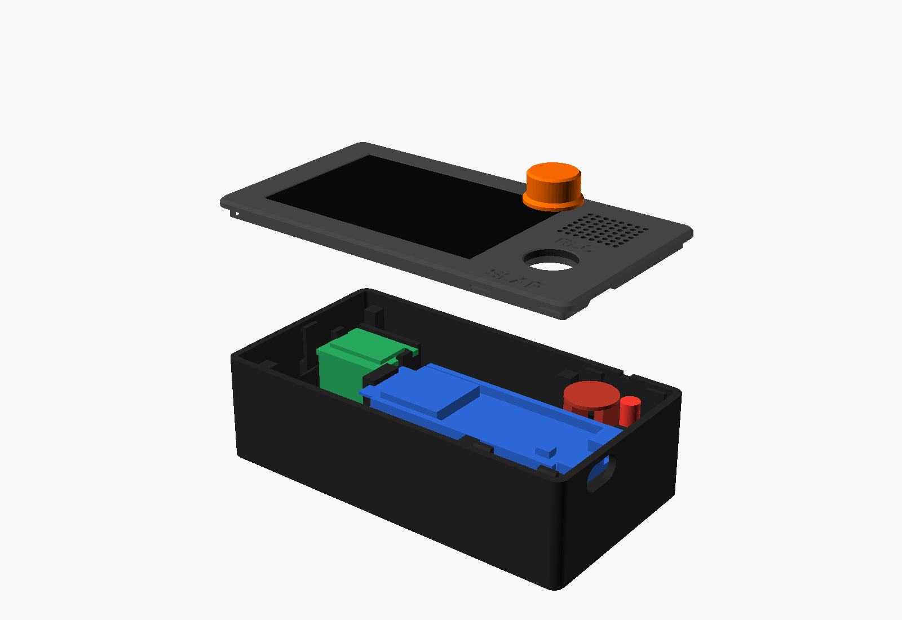

# Slap housing (v2.3): flat, screwless slab

Parametric OpenSCAD housing for the Slap desk device: ESP32-S3-DevKitC-1 (N16R8 clone), 2.42" SSD1309 OLED, INMP441 mic, 5 mm LED, 10-DOF IMU, and a 12 mm record button over BOOT. One file, `housing_slab.scad`, is the source of truth; everything else here (STLs, print plates, STEP for Fusion, previews) is generated from it.




| Printer | Bambu Lab P2S, 0.4 nozzle, textured PEI, black PLA, 0.20 mm Standard, no supports |
|---|---|
| Outer size | **104.5 × 56.0 × 31.4 mm**, 3 mm corner radius, 0.8 mm top chamfer |
| Parts | tray, lid, button. Screwless: five cantilever snap hooks on the tray click into windows in the lid skirt. |
| Print plate | `print/Slap_housing_black_0.4.3mf` (tray, lid face-down, button, plus the mic, USB and OLED-ring coupons), 1 h 58 min, ≈53 g |
| Fusion | `cad/Slap_housing.step` (B-rep solids, see the STEP section) |

Previews: `preview/assembled_black.png`, `assembled_front.png`, `slab_top.png`, `slab_back.png`, `open_box.png` (tray with the parts in place), `lid_under.png`, `exploded.png`, `tray_v23_cradle.png` (close-up of the USB-end cradle).

## Revision history

| Version | Date | What |
|---|---|---|
| v1 | 6 Oct | Angled wedge, screws, loose plunger. Superseded and removed. |
| v2 / v2.1 | 7 Oct | Flat slab, snap-fit lid, Duponts hang under the board on its long pins, two pedestals + snap tabs hold the board. |
| v2.2 | 8 Oct | IMU on a rigid pedestal under the OLED. Print plates and STEP export. |
| **v2.3** | 10 Oct | First print and coupons measured. OLED PCB is 70.1 × 48.0 × 1.0 (stack 4.07), so the slab grew to 56 mm deep. Pegs and clips off (holes not measured); the OLED is sandwiched by four tray posts instead. Mic pocket opened to 15.2. The board snap tabs, which snapped when the cable was pulled, are replaced by a rigid USB-end cradle fused to the end wall; the connector face is 0.2 mm from the wall. `tol_window` 0.3. |

## What the first print showed (9–10 October)

| Finding | Change |
|---|---|
| OLED glass slightly loose in the ring coupon (fine in the lid) | `tol_window` 0.4 → 0.3 |
| OLED PCB 70.1 × 48.0 × 1.0 mm, not the 70.9 × 43.4 guess; the four pegs missed the holes | PCB pocket resized. Pegs and clips **off** (`oled_pegs = false`) until the hole positions are measured. Four 4 mm tray posts (`oled_post`) at the PCB corners press it up into the lid pocket. |
| 14 mm mic did not enter its pocket | `mic_clear` 0.45 per side (pocket 15.2 nominal) |
| Board snap tabs (1.6 mm thick, 23 mm tall) snapped when the USB cable was pulled; connector sat back from the wall | Tabs removed. `usb_cradle()`: a ledge under the pin-free strip, full height under each PCB edge, dropped 1.2 mm in the middle for the USB shell anchor legs, 2 mm cheeks beside the PCB. The lid posts clamp the USB shells from above. `dev_usb_gap` 0.5 → 0.2. The slot cut continues 1.5 mm inside the wall so the cable overmold clears the cheeks. |

Still assumed, in `measurements.md`: OLED hole positions and what is on the PCB back, IMU size and pin lengths, ESP32 pin lengths, Dupont length.

## Outer dimensions

**104.5 × 56.0 × 31.4 mm** (L × W × H).

| Part | Thickness |
|---|---|
| Walls | 2.0 mm |
| Top plate | 2.0 mm, plus a 3 mm skirt that registers inside the tray with 0.2 mm clearance per side |
| Floor | 2.0 mm |

The parts set the size (`L_req`, `W_req` in the echo output):
- **Length:** OLED PCB width (70.1) + the BOOT position (13.8 mm from the board's USB end, which sits against the right wall) + the mic ring between them.
- **Depth:** OLED PCB height (48.0) + the skirt and walls.

## Height budget

**The board column** (Duponts hang under the board):

| Layer | mm | z top |
|---|---|---|
| Floor, `floor_t` | 2.0 | 2.0 |
| Clearance, `floor_clear` | 0.5 | 2.5 |
| Wire exit and bend (wires run horizontally under the board toward the OLED side), `wire_bend` | 2.0 | 4.5 |
| F/F Dupont housing, `jumper_h` | 14.0 | 18.5 |
| Header plastic spacer (the Dupont pushes up against it), `header_spacer` | 2.5 | **21.0** = PCB bottom |
| Dev-board PCB | 1.6 | 22.6 |

The long pins (`dev_pin_below` 9.0, including the spacer) leave 6.5 mm of pin inside each Dupont. That is enough grip; at least 6 mm is needed.

**Above the board, the overall height H is the largest of three stacks:**

| Stack | Layers | H |
|---|---|---|
| **OLED over the ESP32 module (sets H)** | PCB top 22.6 + module shield 3.2 + clearance 0.5 + OLED back parts 1.0 (assumed) + OLED PCB and glass 4.1 (glass flush) | **31.4** |
| Button column | PCB top 22.6 + short pins and solder 2.5 + clearance 0.3 + collar 0.8 and cone + 1.0 upward play + lid 2.0 | 29.7 |
| USB posts | PCB top 22.6 + USB-C 3.26 + 0.2 + post of at least 1 + lid 2.0 | 29.1 |

**Why it is 31.4 and not 26–28.** That estimate left out two things:
1. **The 2.5 mm header spacer.** The Duponts can only push up to the spacer, not to the PCB.
2. **The OLED stacks over the board.** The board is 69 mm long and the slab interior is about 100 mm. The antenna end of the board, carrying the 3.2 mm module shield, always ends up under the OLED. The OLED then needs its own 4.1 mm stack, plus whatever is on its back, above that.

**Ways to lower it** (each is one parameter; the echo output reports which stack is setting H):

| Change | Saves | New H |
|---|---|---|
| Measure the parts on the OLED back; if they are not above the module, `oled_back_keep = 0` | 1.0 | 30.4 |
| Let the glass stand 1 mm proud, `oled_proud = 1` | 1.0 | – |
| Shorter Duponts (`jumper_h`), or solder the wires instead | about 6 for soldered wires | – |

If the first two are applied together, the button column (29.7) becomes the limit.

**OLED and mic headers (the builder solders these).** Fit the header strips with the **long side of the pins pointing into the housing**, at least 6 mm of pin past the plastic spacer, so the Duponts grip.

| Side | Stack | Dupont bottom | Height above the floor top |
|---|---|---|---|
| OLED | OLED back z 27.3, minus spacer 2.5, minus Dupont 14, minus wire bend 2 | z 8.8 | 6.8 mm |
| Mic | lid underside 29.4, minus PCB 1, minus spacer 2.5, minus Dupont 14, minus wire bend 2 | z 9.9 | – |
| LED | Duponts on the legs | z 5.8 | – |

None of these hang over the dev board. The OLED header is on the OLED's back edge, and the mic and LED are behind the board.

## Layout

**Top face, left to right:**
- **OLED:** window 63.41 x 40.45 mm (measured glass plus `tol_window` 0.3 per side). The glass sits flush on a 3.07 mm seat. The 70.1 × 48 mm PCB sits in a pocket under the lid and is pressed up into it by four 4 mm posts in the tray (sandwich hold, no glue). The necked pegs and fork clips are in the file (`oled_pegs = true`) but off until the PCB hole positions are measured. The header goes on the back edge.
- **Control column**, centred on BOOT:
  - Mic grille: 8 x 7 dot grid of 1.2 mm holes at 2.2 mm pitch. The mic port is under a hole.
  - 3 mm LED window, right of the grille and half a pitch further back .
  - **REC** label.
  - **12 mm orange record button.** It is captive: a 13.6 mm collar sits under a 3.7 mm guide bore. Its short nose presses BOOT.
  - **SLAP** label.
  - Both labels are engraved 0.4 mm deep in Helvetica Neue Bold, with every stroke at least 0.5 mm.

**Inside the tray:**
- **Board supports:** two pedestals 19 mm tall under the board's bare centre strip, the only place clear of the header spacers and the hanging Duponts.
  - **USB-end cradle** (v2.3): a ledge fused to the end wall under the 6.3 mm pin-free strip, full height under each PCB edge and dropped 1.2 mm in the middle for the USB shell anchor legs, with 2 mm cheeks beside the PCB. Nothing flexes; the first print's 1.6 mm snap tabs snapped when the cable was pulled.
  - The antenna catch is at the left end.
  - Two lid posts press down on the USB-C shells.
- **Lid joint:** **five** cantilever snap hooks (left end, 2 on the back, 2 on the front).
  - Each beam is 1.2 thick, 5 wide and 9 long, with a 0.8 lip and a 45° lead-in. The beam sits 0.25 mm (`tol_snap`) from the skirt.
  - There is no right-end hook, because the board's USB end fills that wall.
  - The skirt is notched over the USB slot.
- **Pry slot:** 3 x 1 mm on the back edge.
- **Underside:** foot recesses, and the NFC recess under the OLED.

## IMU

**Location:** on the tray floor, **left of the dev board's antenna end, under the OLED.**
- PCB centre at x −34.8, y +8.0, with the header edge toward the front.
- The PCB sits at z 21.0–22.6, the same height as the dev board.
- This is the only free floor area large enough. The control-panel strip is taken by the board's USB end, the mic and LED Duponts, and the snap hooks.
- The x position is centred automatically between the left wall (1 mm flex room for the tab) and the antenna tip.

**Mount:**
- A solid pedestal from the floor (rigidly coupled, so a slap on the lid reaches the MPU6050 as a Z spike) under everything except the 3.4 mm header strip.
- A 1 mm locating fence on the far edge.
- Two pegs in the assumed mounting holes.
- Two snap tabs (0.8 mm lip) on the short ends: drop the IMU onto the pegs and it clicks under the tabs.
- The sensor axes line up with the slab: X along the length, Y front to back, Z up.

**Wiring:** F/F Duponts on the header pins hang down under the header edge, the same stack as the dev board: 2.5 floor + clearance, 2 wire bend, 14 housing, 2.5 spacer.

**Clearances:**
- The IMU top is at z 23.8 with its parts on, under the OLED's back-parts zone at z 26.3.
- `clash_check` includes the IMU ghost (PCB, parts, header spacer, Duponts plus wire bend on every pin) and stays at zero non-zero-volume intersections.

**Coupon:** `stl/slab_fit_imu.stl` is a full-height pedestal on a floor stub, so the tabs flex as they will in the tray. It is also on the `fit_tests` plate.

**Grip warning:** with the assumed 6 mm pin protrusion *including* the 2.5 mm spacer, only 3.5 mm of pin reaches into a Dupont (6 is needed). The echo output warns about this. Measure the pins. If they are short, fit a long-pin header, or solder the 5 wires.

**All IMU dimensions are assumed** (`imu_*` parameters):

| Parameter | Value |
|---|---|
| PCB | 22 x 17 x 1.6 |
| Tallest part | 1.2 |
| Header pins | 8, row 1.27 from the edge |
| Header spacer | 2.5 |
| Pin protrusion below the PCB | 6.0 |
| Mounting holes | Ø3.0 at (±8.5, +5.5) from the PCB centre |

The pegs and tabs use `tol_fit`.

## Design decisions

1. **USB-C is in the right end wall, not the back.** The ports are on the board's short end, and the 69 mm board cannot run front to back in a 51 mm deep slab. By default only the UART/COM port has a slot (12.8 x 7.3). Since v2.1 dropped the right-end hook, `usb_slot_mode="both"` (one 26.2 x 7.3 slot) and `"two"` also render and pass `clash_check`, but the clash check only models one plug, on the UART port.
2. **NFC is underneath only.** No free 30 x 30 area is left on top.
3. **The OLED is held by a sandwich**, not by pegs and clips, until the PCB holes are measured.
4. **Five lid hooks, not six** (the brief allows 4 to 6).
5. **H = 31.4** (see the height budget above).
6. **Board support is two centre pedestals plus the USB-end cradle, not side rails or corner standoffs.** Rails along the long edges would collide with the header spacers and hanging Duponts. The antenna-end corners have pins in them.

## FDM tolerances (`tol_*` block at the top of the file)

These are for a Bambu P2S with a 0.4 nozzle and PLA.

| Parameter | Value | Applies to |
|---|---|---|
| `tol_hole` | +0.3 on diameter | every printed round hole or bore: grille, LED bore/window, button bore, mic pocket, clip end holes, foot recesses |
| `tol_fit` | 0.2 per side | skirt to tray, OLED PCB pocket, cradle cheeks, IMU tab gap and lip clearance, post gap, antenna slot, NFC recess |
| `mic_clear` | 0.45 per side | mic pocket (0.2 was too tight on the first print) |
| `tol_snap` | 0.25 | gap from lid-hook beam to skirt (lip engagement = 0.8 − 0.25) |
| `tol_window` | 0.3 per side | OLED window, USB-C slot (0.4 printed slightly loose) |
| `tol_efoot` | 0.3 | first-layer chamfer or inset: tray bottom edge, window and button-bore bevels, clips, coupons |
| `tol_min_wall` / `tol_min_feat` | 1.2 / 0.8 | checked by `assert`. The grille holes are capped at 1.4 so 0.8 mm walls remain between them. |
| `tol_shaft` | 0.3 | button cap is 0.3 under its nominal bore |
| `tol_text_stroke` / `tol_text_depth` | 0.5 / 0.4 | label strokes and engraving depth |

## Dimension sources and the tolerance on each

| Dimension | Value | Source | Modelled as | Tolerance |
|---|---|---|---|---|
| OLED glass | 62.81 x 39.85 | measured | window 63.41 x 40.45 | `tol_window` |
| OLED glass + PCB stack | 4.07 | measured | seat 3.07 below the top (flush) | – |
| OLED PCB outline | 70.1 x 48.0 | measured | pocket 70.5 x 48.4 | `tol_fit` |
| OLED PCB thickness | 1.0 | measured | sets the seat depth | – |
| OLED back parts | 1.0 | assumed | height budget | – |
| OLED holes | 2.2 at 3.0 inset | assumed, **pegs off** | pegs 1.8, neck 1.2 when enabled | `tol_fit` |
| OLED clip slot | 1.0 on a 1.2 neck | design | end hole 1.5 | `clip_snap`, `tol_hole` |
| INMP441 PCB | 14.0 | measured | pocket 15.2 | `mic_clear` + `tol_hole` |
| Grille holes | 1.2 at 2.2 pitch | design | 1.4 | `tol_hole`, capped by `tol_min_feat` |
| LED body | 5.0 | datasheet | bore 5.3 (snug) | `tol_hole` |
| LED window | 3.0 | design | 3.3 | `tol_hole` |
| Button cap | 12.0 | design | bore 12.6 (prints about 12.3) | `tol_shaft` + `tol_hole` |
| Dev board (PCB, pin pitch and inset, USB, BOOT) | 62.74 x 25.4 etc. | datasheet (Espressif drawing; positions scaled, ±0.5) | – | – |
| ESP32 module shield | 3.2 | datasheet (WROOM-1, 3.1 ±0.15) | height budget | – |
| Header spacer | 2.5 | datasheet (standard 2.54 header) | – | – |
| Long pins below / short pins above the PCB | 9.0 / 2.5 | assumed | – | – |
| USB-C receptacle height | 3.26 | datasheet | post gap 0.2 | `tol_fit` |
| USB-C overhang past the PCB | 0.8 | assumed | – | – |
| Cable overmold | 12.0 x 6.5 | assumed | slot 12.8 x 7.3 | `tol_window` |
| Module PCB at the antenna | 0.8 | datasheet | slot 1.4 | `tol_fit` |
| Dupont housing | 14 x 2.54 | assumed | height budget | – |
| BOOT key height | 2.0 | assumed | button nose | – |
| Rubber feet | 8 | assumed | 8.3 x 0.6 | `tol_hole` |
| IMU PCB | 22 x 17 x 1.6 | assumed | pedestal + fence | `tol_fit` |
| IMU mounting holes | Ø3.0 at (±8.5, +5.5) | assumed | pegs 2.6 | `tol_fit` |
| IMU header (pins, spacer, protrusion) | 8 pins, 2.5, 6.0 | assumed | Dupont stack | – |
| NFC sticker | 30 x 30 | assumed | 30.4 x 0.4 | `tol_fit` |

### What to change after the coupons

| Coupon result | Change |
|---|---|
| Glass tight or loose in `fit_oled_ring` | `tol_window` |
| OLED PCB tight or loose in the lid pocket, or rattles when closed | `tol_fit`, `oled_post_gap` |
| Pegs won't enter the PCB holes | `oled_hole_d` / `oled_hole_inset_*`, then `tol_fit` |
| Mic loose or tight in its ring | `mic_clear` |
| LED loose in its socket | `tol_hole` (smaller = tighter) |
| Grille holes closed up | `grille_hole` |
| Button sticks or wobbles | `tol_shaft` |
| Lid hook too stiff, cracks, or won't latch | `tol_snap` up (stiffer) or down, `hook_len` longer = softer |
| Lid won't come off | `hook_return` lower |
| Board tight or loose between the cradle cheeks | `tol_fit` |
| IMU won't drop onto the pegs, or rattles in `fit_imu` | `imu_holes` / `imu_hole_d`, then `tol_fit` |
| IMU tabs won't click | `tab_lip`, `imu_pcb_t` |
| Cable won't fit | `usb_plug_w/h`, then `tol_window` |

`tol_hole` affects every round hole at once. Change it only if several holes are wrong in the same direction.

## Print settings (Bambu Studio)

- **Printer and process:** P2S, 0.4 nozzle, **0.20mm Standard @BBL P2S**, Textured PEI Plate, black PLA, 3 walls, 15 % infill, supports off.
- **Elephant-foot compensation:** the model already has a 0.3 mm first-layer chamfer; leave Bambu's default.
- Open `print/Slap_housing_black_0.4.3mf`: each part is its own object, already oriented and laid out. For a faster draft use *0.24mm Standard*; keep 0.20 for the final so the hooks and lettering stay crisp.

| Part | File | Orientation and notes |
|---|---|---|
| lid | `stl/slab_top.stl` | **Face-down.** Flat, evenly textured top; window bevel, grille holes and engraved letters start on the plate. Everything underneath points up, no support. |
| tray | `stl/slab_tray.stl` | Floor-down. The lid hooks stand on 45° support blocks. Pedestals, cradle and OLED posts are straight up. The antenna-catch jaw overhangs about 2.5 mm. The NFC and foot recesses are bridged at layer 3. |
| button | `stl/slab_button.stl` | Standing on the cap, 7.8 mm long. Brim only if it tips. |
| labels (optional) | `stl/slab_labels.stl` | AMS inlay. Load it with `slab_top` as one object with two parts. |
| coupons | `stl/slab_fit_*.stl`, plate `print/Slap_fit_tests_black_0.4.3mf` | snap hook, OLED ring, mic pocket + LED, USB slot, BOOT bore + plunger, IMU pedestal. 35 min. |

Plates are built by `print/build_plates.py` (needs the `cad/` environment: `uv run --project cad python print/build_plates.py` from this folder). It checks every body is watertight, orients and lays the parts out, and writes the 3MFs.

## Fit-test coupons

1. **OLED ring:** the glass drops into the window with a small even gap.
2. **Mic plate:** mic bare side down in the round pocket, port over the small hole; LED pushes into the 5.2 mm hole; grille holes open.
3. **USB bar:** the cable's overmold passes the slot.
4. **BOOT block:** the plunger slides freely with no visible wobble.
5. **Snap stubs:** the hook clicks into the window and pulls off without cracking.
6. **IMU stub:** the board drops onto the pegs and the tabs click.

Then the housing plate. Results map to parameters in the table above.

## Assembly and opening

1. **Solder** the OLED and mic headers with the long pin side pointing inward, at least 6 mm.
2. **Lid (lying face-down):** press the LED into its socket; seat the mic bare side down in its ring with the strips running front to back; lay the OLED glass-down into its pocket; drop the button cap-first into its bore.
3. **Dev board:** push the Duponts onto the long pins under the board first. Lay the board component-side up on the pedestals with the wires running under it toward the OLED side. Slide the antenna tip under the catch (toward −X), then lower the USB end into the cradle between the cheeks.
4. **IMU:** push its 5 Duponts on, then press it onto the pedestal pegs until both tabs click.
5. **Connect** the OLED, mic, LED and IMU Duponts (`../wiring.md`; the IMU shares the I2C bus).
6. **Close:** lower the lid straight down and press until all five hooks click. The posts then rest on the USB-C shells and the OLED is pinched between the lid pocket and the four tray posts.
7. **To open:** put a spudger in the back pry slot and lift.

## Rendering and checks

```sh
openscad --backend=Manifold -o stl/slab_top.stl -D 'part="top"' housing_slab.scad   # same for tray, button, fit_*
openscad --backend=Manifold -o /tmp/clash.stl -D 'part="clash_check"' housing_slab.scad  # only zero-volume contacts expected
```

`clash_check` intersects the printed parts with the board (PCB, header spacers, short pins, Duponts with their 2 mm wire bend on the 12 used pins), the OLED with its header Duponts, the mic, the LED, the IMU with its spacer and Duponts, the USB plug and the button. v2.3 leaves zero non-zero-volume intersections. The lid STL comes out of OpenSCAD with a few zero-area sliver faces at the skirt catch windows; `build_plates.py` expects watertight meshes, so repair it first (trimesh: drop degenerate faces, `fill_holes`; volume unchanged).

## Fusion / STEP (CadQuery)

`cad/housing_slab_cq.py` rebuilds the v2.3 slab in CadQuery so it opens as real B-rep solids in Fusion. `housing_slab.scad` is still the source of truth: the parameter block at the top of the script uses the same names and values. Change a value in the SCAD first, copy it into the script, then regenerate.

**Regenerate** (from `hardware/housing`; the first run creates `cad/.venv`):

```sh
uv run --project cad python cad/housing_slab_cq.py              # build, export, compare with fresh OpenSCAD exports, re-read the STEPs
uv run --project cad python cad/housing_slab_cq.py --no-verify  # build and export only
```

**Outputs in `cad/`:**

| File | Contents |
|---|---|
| `Slap_housing.step` | Assembly, closed position: `Tray`, `Lid`, `Button` (3 solids) |
| `Slap_tray.step`, `Slap_lid.step` | Single bodies in assembly coordinates |
| `Slap_button.step` | Button, nose-down, z = 0 at the nose tip |
| `Slap_housing_cq.stl` | Mesh of the closed assembly, for comparison only. Print from `print/` |

With `oled_pegs` off there are no clips, so `Slap_oled_clip.step` is not exported.

**Check against OpenSCAD** (10 October 2026, v2.3; the script exports fresh reference STLs from the SCAD and compares):

| Body | Volume CQ / SCAD (mm³) | Δ volume | Bbox Δ | Surface deviation, max | STEP faces |
|---|---|---|---|---|---|
| Tray | 47866.17 / 47864.60 | +0.003 % | 0.000 mm | 0.009 mm | 175 |
| Lid | 8488.45 / 8491.18 | −0.032 % | 0.000 mm | 0.019 mm | 419 |
| Button | 829.74 / 827.53 | +0.27 % | 0.000 mm | 0.015 mm | 8 |

Every exported STEP reads back as valid solids. The remaining differences are OpenSCAD's 48-sided polygons versus true circles; the cradle, posts and slot are plain boxes and match exactly.

**Open in Fusion:** File → Open → **Open from my computer…** → choose `cad/Slap_housing.step`, or a single-part STEP. The assembly comes in as components Tray, Lid and Button, in mm, closed, with Z up. For editing, open the single-part STEP files; they arrive as plain bodies with no feature history.
